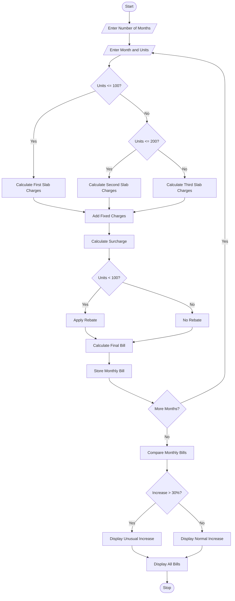

## 1.Problem Statement
Develop a Python program to calculate household electricity bills using progressive consumption slabs. The system calculates charges based on electricity units consumed, fixed charges, surcharges, and rebates. It compares electricity bills across several months and identifies unusual increases in monthly bills.
## 2.Algorithm
1. Start the program.
2. Enter the number of months.
3. Enter the month name and electricity units consumed.
4. Calculate the electricity charges using progressive slabs:
   - First 100 units: ₹2 per unit.
   - Next 100 units: ₹3 per unit.
   - Above 200 units: ₹5 per unit.
5. Add fixed charges of ₹50.
6. Calculate a surcharge of 5% on the energy charges.
7. Apply a 5% rebate if consumption is below 100 units.
8. Calculate the final electricity bill.
9. Store the monthly bill details.
10. Compare bills of consecutive months.
11. Identify unusual increases when the bill increases by more than 30%.
12. Display monthly bills and unusual increases.
13. Stop the program.

## 3.sampel input
Enter number of months: 3

Month 1
Enter month name: January
Enter electricity units: 80

Month 2
Enter month name: February
Enter electricity units: 120

Month 3
Enter month name: March
Enter electricity units: 250

## 4. Sample Output

--- Monthly Electricity Bills ---

January - Units: 80.0 - Bill: Rs. 202.0
February - Units: 120.0 - Bill: Rs. 365.0
March - Units: 250.0 - Bill: Rs. 927.5

--- Unusual Bill Increases ---

Unusual increase in February
Increase: 80.69 %

Unusual increase in March
Increase: 154.11 %

Total Months: 3
Program Completed.

## 5. Mermaid Flowchart Code

Copy the following code into a Mermaid-compatible editor to generate a flowchart.
 mermaid

## 8.Conclusion
The Progressive Electricity Billing System calculates household electricity bills using different consumption slabs, fixed charges, surcharges, and rebates. It compares monthly bills and identifies unusual increases. This program reduces manual calculations and helps households monitor their electricity expenses.
