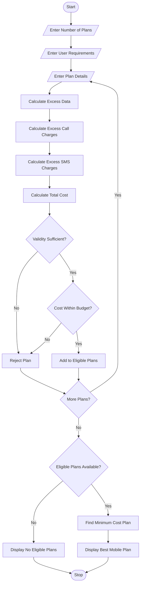

## 1.Problem Statement
Develop a Python program to compare multiple mobile recharge plans based on data usage, call minutes, SMS, validity, and budget constraints. The system calculates the total cost of each plan, including excess usage charges. It identifies plans that satisfy the user's requirements and selects the most economical eligible plan.

## 2. Algorithm
1. Start the program.
2. Enter the number of mobile plans.
3. Enter the user's requirements:
   - Required data in GB.
   - Required call minutes.
   - Required SMS.
   - Required validity in days.
   - Maximum budget.
4. Enter the details of each mobile plan:
   - Plan name.
   - Plan price.
   - Included data.
   - Included call minutes.
   - Included SMS.
   - Validity.
5. Calculate excess data, call, and SMS usage.
6. Calculate excess charges:
   - Extra data: ₹10 per GB.
   - Extra call: ₹1 per minute.
   - Extra SMS: ₹0.50 per SMS.
7. Calculate the total cost of each plan.
8. Check whether the plan satisfies validity and budget requirements.
9. Identify eligible plans.
10. Select the plan with the lowest total cost.
11. Display all plan costs and the most economical eligible plan.
12. Stop the program.

## 3.sample input
Enter number of mobile plans: 3

Enter required data (GB): 3
Enter required call minutes: 500
Enter required SMS: 100
Enter required validity (days): 28
Enter maximum budget: 300

Enter Plan Details
Enter plan name: Basic
Enter plan price: 150
Enter included data (GB): 2
Enter included call minutes: 400
Enter included SMS: 100
Enter validity days: 28

Enter Plan Details
Enter plan name: Smart
Enter plan price: 220
Enter included data (GB): 3
Enter included call minutes: 500
Enter included SMS: 100
Enter validity days: 28

Enter Plan Details
Enter plan name: Premium
Enter plan price: 280
Enter included data (GB): 5
Enter included call minutes: 600
Enter included SMS: 200
Enter validity days: 56

## 4.sample output

Plan: Basic
Base Price: Rs. 150.0
Extra Data Charge: Rs. 10.0
Extra Call Charge: Rs. 100
Extra SMS Charge: Rs. 0.0
Total Cost: Rs. 260.0

Plan: Smart
Base Price: Rs. 220.0
Extra Data Charge: Rs. 0.0
Extra Call Charge: Rs. 0
Extra SMS Charge: Rs. 0.0
Total Cost: Rs. 220.0

Plan: Premium
Base Price: Rs. 280.0
Extra Data Charge: Rs. 0.0
Extra Call Charge: Rs. 0
Extra SMS Charge: Rs. 0.0
Total Cost: Rs. 280.0

--- BEST MOBILE PLAN ---

Selected Plan: Smart
Total Cost: Rs. 220.0
Eligible Plans: 3

Program Completed.

## 5. Mermaid Flowchart Code

Copy the following code into a Mermaid-compatible editor to generate a flowchart.
 mermaid

 ## 6. Conclusion
The Multi-Plan Telecommunications Cost Optimization System compares different mobile recharge plans based on data, calls, SMS, validity, and budget. It calculates additional usage charges and identifies the most economical eligible plan. This Python program helps users select suitable mobile plans while reducing unnecessary expenses.
