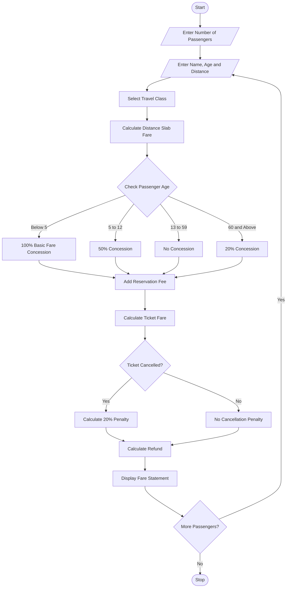

## 1. Problem Statement
Develop a Python program to calculate railway fares for multiple passengers based on distance travelled, travel class, age-based concessions, reservation fees, and cancellation penalties. The system calculates the basic fare using distance slabs, applies concessions for eligible passengers, adds reservation charges, and calculates the final amount. If a passenger cancels a ticket, the specified cancellation penalty is deducted from the fare. Finally, the program displays the fare details for each passenger.

## 2. Algorithm
1. Start the program.
2. Enter the number of passengers.
3. Enter passenger name, age, and travel distance.
4. Select the travel class:
   - Sleeper – ₹1.5 per km.
   - AC 3 Tier – ₹2.5 per km.
   - AC 2 Tier – ₹3.5 per km.
5. Calculate basic fare based on distance slabs:
   - First 100 km: Normal rate.
   - Next 100 km: 10% additional charge.
   - Above 200 km: 20% additional charge.
6. Apply age-based concessions:
   - Children below 5 years: Free basic fare.
   - Children aged 5–12 years: 50% concession.
   - Senior citizens aged 60 and above: 20% concession.
   - Others: No concession.
7. Add reservation fee of ₹50.
8. Calculate the final ticket fare.
9. Ask whether the ticket is cancelled.
10. If cancelled, apply a 20% cancellation penalty on the ticket fare.
11. Calculate the refund amount.
12. Display the passenger fare statement.
13. Repeat for all passengers.
14. Stop the program.

## 3. sample input

Enter number of passengers: 2

Enter Passenger Details
Enter passenger name: Harika
Enter passenger age: 20
Enter travel distance in km: 150

Select Travel Class
1. Sleeper - Rs. 1.5/km
2. AC 3 Tier - Rs. 2.5/km
3. AC 2 Tier - Rs. 3.5/km

Enter class choice: 1
Cancel ticket? (yes/no): no

Enter Passenger Details
Enter passenger name: Priya
Enter passenger age: 65
Enter travel distance in km: 250

Select Travel Class
1. Sleeper - Rs. 1.5/km
2. AC 3 Tier - Rs. 2.5/km
3. AC 2 Tier - Rs. 3.5/km

Enter class choice: 2
Cancel ticket? (yes/no): yes

## 4. sample output
------ RAILWAY FARE STATEMENT ------

Passenger Name: Harika
Age: 20
Travel Class: Sleeper
Distance: 150.0 km
Concession: Rs. 0
Reservation Fee: Rs. 50
Ticket Fare: Rs. 297.5
Ticket Status: Confirmed
Cancellation Penalty: Rs. 0
Refund Amount: Rs. 297.5

-----------------------------------

------ RAILWAY FARE STATEMENT ------

Passenger Name: Priya
Age: 65
Travel Class: AC 3 Tier
Distance: 250.0 km
Concession: Rs. 155.0
Reservation Fee: Rs. 50
Ticket Fare: Rs. 670.0
Ticket Status: Cancelled
Cancellation Penalty: Rs. 134.0
Refund Amount: Rs. 536.0

-----------------------------------

Railway Reservation Completed.

## 5. Mermaid Flowchart Code

Copy the following code into a Mermaid-compatible editor to generate a flowchart.
 mermaid

## 6. Conclusion
The Railway Fare and Reservation Calculator calculates ticket fares based on distance, travel class, and passenger age. It applies concessions, reservation fees, and cancellation penalties. This Python program simplifies railway fare calculations and generates clear passenger fare statements.

Note: The fare rates, concessions, reservation fees, and cancellation penalties used in this program are assumed academic values, not actual Indian Railways booking rules.
